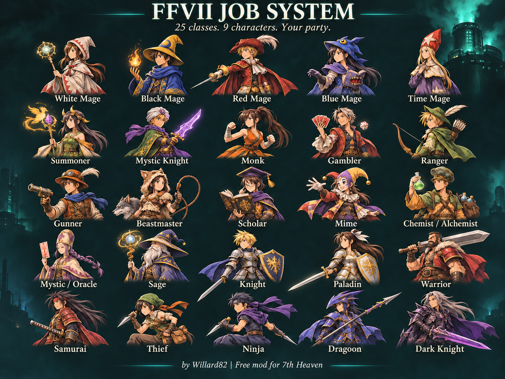

# FFVII Job System

**By Willard82** · A free mod for original English Final Fantasy VII on PC, using 7th Heaven.



Choose one of **25 Final Fantasy classes** for each of the nine characters before launching the game. Each class has its own Materia permissions, and character weapon icons show who can equip each Materia. Characters can share a class.

Configure Mod includes class descriptions, complete Materia lists and a reference for all 32 accessories. **Accessory class suggestions are informational:** active accessory permissions still follow the existing character rules.

## Download and install

Download **[FFVII Job System 1.0.0](https://github.com/WailSolaiman/ffviijobs/releases/download/v1.0.0/FFVIIJobSystem-1.0.0.iro)** from the [public release](https://github.com/WailSolaiman/ffviijobs/releases/tag/v1.0.0). Import it into 7th Heaven, activate **FFVII Job System**, and open **Configure Mod** to choose your classes. Changes apply on the next launch.

Materia with no eligible selected character remain visible, without weapon icons, and cannot be equipped. Previously equipped forbidden Materia return to inventory with their AP. If inventory is full, they are preserved but inactive during stat and command calculations until space is available.

See [the installation guide](README.txt) and [the complete class permissions](CLASS_PERMISSIONS.txt).

## Compatibility

Tested with the English Steam FF7 PC 1.02 executable, 7th Heaven 4.6.1, FFNx 1.25.2.0 and Enhanced Stock UI 2.968. Other languages and gameplay overhauls that change Materia IDs or the same executable hooks are unverified.

The current source release is **1.0.0**, displayed as **1.00** in 7th Heaven.
It uses 7th Heaven's supported **LoadLibrary** mechanism for `FFVIIJobs.dll`.
The normal executable-code warning appears when activating the mod. There is
no HEXT bootstrap or separately loaded executable `.bin` payload. 7th Heaven's
security settings and consent mechanism are unchanged. Private native and
installed-7H integration checks pass; in-game testing is still required.
Saved class selections are preserved. New
configurations default Barret to Paladin and Cait Sith to Gambler. Current
Materia permissions are listed in [the complete class permissions](CLASS_PERMISSIONS.txt).

## Build from source

Build on Windows with Python 3, Pillow, pefile, Windows Segoe UI fonts and Zig 0.17.1:

```powershell
py -m pip install Pillow pefile
py source/build.py --zig C:/path/to/zig.exe
py source/package.py
```

The build creates the standard x86 DLL and configuration previews. Packaging creates the IRO and a source ZIP. Compiled binaries and archives are excluded from Git; the DLL is included in the packaged download. See [DLL loading](source/DLL_LOADING.md).

Validation details are in [VALIDATION.txt](VALIDATION.txt). The `source` folder also contains private native, loader, configuration and metadata verification tools, which do not require launching FF7.

## Publishing

The **[1.0.0 release](https://github.com/WailSolaiman/ffviijobs/releases/tag/v1.0.0)** is public and its downloads have been verified. The **[community catalogue submission](https://github.com/tsunamods-codes/7th-Heaven-Catalogs/pull/525)** is awaiting maintainer review and merge. Once accepted into the catalogue, users can discover and install it through 7th Heaven. See [publication status](PUBLISHING.txt).

## Feedback and support

[Report an issue](https://github.com/WailSolaiman/ffviijobs/issues). Please include your game language, mod version, 7th Heaven version and enabled mods.

If you enjoy the mod, you can [buy Willard82 a coffee](https://ko-fi.com/ffviijobs). The mod is free, and tips are always optional.

The preview is an illustrated roster generated using classic Final Fantasy job artwork as visual references. See [art sources](ART_SOURCES.txt) and the included generation/edit prompts. This is an unofficial fan-made mod.
